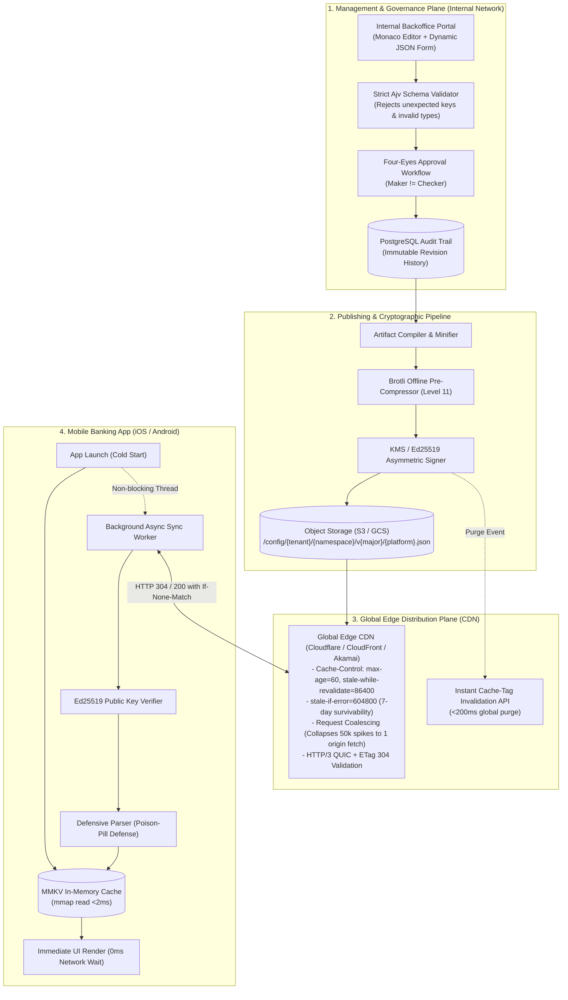

<div align="center">

# 🏦 Remote Config Edge Platform
### Mission-Critical, Edge-Distributed Dynamic Configuration & Menu Platform for High-Traffic Mobile Banking

[](https://github.com/llucasmota/remote-config-edge/actions/workflows/ci.yml)
[](https://www.typescriptlang.org/)
[](https://nodejs.org/)
[](https://fastify.dev/)
[](https://vitest.dev/)
[](LICENSE)

*Ultra-low latency (<25ms) • Zero-downtime resilience • 0ms cold-start mobile startup • JSON Schema governance • Ed25519 cryptographic signing*

---

</div>

## 📌 Table of Contents
- [Overview](#-overview)
- [The Problem: Why Traditional Remote Config Fails at Scale](#-the-problem-why-traditional-remote-config-fails-at-scale)
- [Architectural Solution](#-architectural-solution)
  - [High-Level System Architecture](#high-level-system-architecture)
  - [Domain Decomposition & Namespaces](#domain-decomposition--namespaces)
- [Resilience & High Availability Strategies](#-resilience--high-availability-strategies)
  - [Total Origin Outage Survival (stale-if-error)](#1-total-origin-outage-survival-stale-if-error)
  - [Zero-Latency Cold Starts (0ms Mobile UI Block)](#2-zero-latency-cold-starts-0ms-mobile-ui-block)
  - [Thundering Herd & Request Coalescing](#3-thundering-herd--request-coalescing)
  - [Sub-300B Conditional Sync (HTTP 304 ETag)](#4-sub-300b-conditional-sync-http-304-etag)
  - [Poison-Pill Defense (Defensive Client Parsing)](#5-poison-pill-defense-defensive-client-parsing)
- [Security & Banking Governance](#-security--banking-governance)
  - [Ed25519 Cryptographic Signatures](#ed25519-cryptographic-signatures)
  - [Strict JSON Schema Enforcement](#strict-json-schema-enforcement)
  - [Maker-Checker (Four-Eyes Principle)](#maker-checker-four-eyes-principle)
- [Edge Delivery & CDN Invalidation](#-edge-delivery--cdn-invalidation)
- [Technology Stack](#-technology-stack)
- [Repository Structure](#-repository-structure)
- [Getting Started](#-getting-started)
- [Testing & Quality Assurance](#-testing--quality-assurance)
- [Roadmap & Sprints](#-roadmap--sprints)

---

## 📖 Overview

**Remote Config Edge Platform** is an enterprise-grade, edge-distributed configuration and Server-Driven UI (SDUI) distribution engine engineered specifically for tier-1 mobile banking applications with millions of Daily Active Users (DAUs).

Instead of treating all parameters as a monolithic key-value blob over a centralized service, this platform separates lightweight runtime feature flags from large dynamic UI navigation trees, compiling them into **immutable, cryptographically signed, pre-compressed static edge artifacts** delivered via a global CDN.

---

## ⚡ The Problem: Why Traditional Remote Config Fails at Scale

In high-volume mobile banking applications, off-the-shelf platforms like Firebase Remote Config encounter severe architectural bottlenecks:

```
❌ MONOLITHIC PAYLOADS
   Huge menu JSONs (150KB+) bundled with tiny boolean flags force massive downloads on cold start.

❌ LACK OF BANKING GOVERNANCE
   No strict JSON Schema enforcement. A missing key or syntax error entered in a console can crash millions of app sessions.

❌ ZERO MAKER-CHECKER WORKFLOW
   Regulatory standards require dual-approval (four-eyes principle) before releasing configuration changes to production.

❌ THUNDERING HERD & RATE LIMITS
   Morning peaks or salary payday traffic cause concurrent client fetches to spike, triggering rate limits and latency degradation.
```

### Comparative Summary

| Challenge | Traditional Remote Config (e.g., Firebase) | Remote Config Edge Platform |
| :--- | :--- | :--- |
| **Payload Structure** | Monolithic dictionary (all keys downloaded together) | Segmented Namespaces (`features`, `navigation_menu`) |
| **Validation** | Basic or absent (raw string/JSON parsing) | Strict JSON Schema (Draft-07 / 2020-12) via Ajv JIT |
| **Contract Safety** | Accepts arbitrary properties | `"additionalProperties": false` rejects unknown keys |
| **Tamper Resistance** | HTTPS transport security only | Asymmetric cryptographic envelope (**Ed25519**) |
| **Mobile Cold Start** | Network fetch or slow local key-value store | **0ms wait**: In-memory MMKV read + background ETag sync |
| **Origin Resilience** | Outage at origin affects client updates | **Survives complete origin outage for 7+ days** via CDN stale cache |
| **Bandwidth Overhead** | Full payload re-downloaded frequently | **<300 Bytes** HTTP 304 (Not Modified) responses |

---

## 🏛️ Architectural Solution

The architecture follows the **Edge-Distributed Immutable Artifacts Pattern**:

### High-Level System Architecture



### Domain Decomposition & Namespaces

Instead of a monolithic blob, configurations are decoupled into isolated, versioned namespaces:

1. **`features` (`feature-config.json`):** Boolean flags, operational toggles, and limits (e.g., `enable_pix_v2`, `minVersion: 1.0`, `userType: ["PF", "PJ"]`). Payload size: ~2KB.
2. **`navigation_menu` (`menu-config.json`):** Dynamic Server-Driven UI menu trees, UUID v5 identifiers, deep-link patterns (`bank://[a-z0-9_/]+$`), icon mappings, and permissions. Payload size: ~30KB - 80KB.
3. **`home_layout`:** Dynamic widget sequencing, promotional banners, and contextual card ordering.

---

## 🛡️ Resilience & High Availability Strategies

### 1. Total Origin Outage Survival (`stale-if-error`)
Every configuration delivered by the CDN carries aggressive, resilient HTTP caching headers:
```http
Cache-Control: public, max-age=60, stale-while-revalidate=86400, stale-if-error=604800
ETag: "sha256-rev-1043"
Vary: Accept-Encoding
Content-Encoding: br
```
* **`stale-if-error=604800` (7 Days of Autonomy):** If the origin S3 bucket, internal database, or publishing backend experiences a catastrophic failure, edge nodes will continue serving the last known valid configuration for up to **7 days**. Customers never encounter broken screens or initialization errors.
* **`stale-while-revalidate=86400`:** If a cache TTL expires before a purge event occurs, the edge node returns the cached version instantly to the user while asynchronously validating against the origin in the background.

### 2. Zero-Latency Cold Starts (0ms Mobile UI Block)
The mobile app **never blocks UI rendering** waiting for network responses on startup:
* **Storage Layer:** Uses **MMKV** (Tencent's memory-mapped key-value store using `mmap`), which reads a 40KB menu from disk into memory in **<2 milliseconds** (up to 50x faster than Android `SharedPreferences` or iOS `UserDefaults`).
* **Bundled Fallback Defaults:** Every released binary includes an embedded `bundled_defaults.json`. First-time users opening the app in airplane mode or subway tunnels get a fully functional experience.

### 3. Thundering Herd & Request Coalescing
During major morning traffic spikes or payday surges:
* The CDN enforces **Request Collapsing / Request Coalescing**.
* If 50,000 devices request a purged configuration simultaneously, the edge node holds 49,999 requests and fires **a single request** to the S3 origin. Once answered, all 50,000 connections are resolved in parallel, shielding origin infrastructure from traffic spikes.

### 4. Sub-300B Conditional Sync (HTTP 304 ETag)
Mobile background checks send `If-None-Match: "sha256-rev-1043"`:
* If the configuration has not changed, the CDN immediately responds with **HTTP 304 Not Modified**.
* Payload size is **<300 bytes** (headers only, zero body).
* Reduces cellular data consumption and origin egress costs by **over 98%**.

### 5. Poison-Pill Defense (Defensive Client Parsing)
* Even with strict schema validation in the control plane, mobile client SDKs parse arrays with fault tolerance.
* If a single menu item in an array of 20 elements contains a malformed field or unknown enum, the parser safely discards **only that individual element** and renders the remaining 19. The application **never crashes**.

---

## 🔒 Security & Banking Governance

### Ed25519 Cryptographic Signatures
To protect against Man-in-the-Middle (MITM) attacks, rogue CDNs, or DNS spoofing:
1. The backend signs the minified JSON artifact using an asymmetric **Ed25519 private key** managed in an HSM / AWS KMS.
2. The payload is encapsulated in a tamper-proof envelope:
   ```json
   {
     "revision": 1043,
     "timestamp": "2026-10-29T12:00:00Z",
     "signature": "MC4CAQAwBQYDK2VwBCIEIP...==",
     "data": { /* verified payload */ }
   }
   ```
3. The mobile application carries the corresponding **Ed25519 public key** embedded in its binary. If a single byte is altered, signature verification fails and the update is discarded.

### Strict JSON Schema Enforcement
All schemas follow official **JSON Schema (Draft-07 / 2020-12)** with:
* `"additionalProperties": false` to reject unknown/unauthorized properties.
* Strict regular expressions for UUIDs (`^[0-9a-fA-F]{8}-...`), deep links (`^bank://...`), and allowed enums.
* Pre-compiled JIT execution via `Ajv` providing microsecond-level validation throughput.

### Maker-Checker (Four-Eyes Principle)
For enterprise compliance:
* A configuration change created by a **Maker** is saved as a `PENDING_APPROVAL` draft.
* A separate **Checker** must review a visual line-by-line diff and impact analysis before triggering publishing.
* A complete, immutable audit trail records timestamps, user IDs, rationale, and exact SHA-256 hashes.

---

## ⚡ Edge Delivery & CDN Invalidation

```
[ Maker Approves Draft ]
           │
           ▼
[ Publisher Service (<300ms) ]
  ├── 1. Ajv Strict Schema Validation
  ├── 2. Minification & Ed25519 Cryptographic Signing
  ├── 3. Offline Brotli Pre-Compression (Level 11)
  └── 4. Concurrent Upload to S3 (JSON + .br)
           │
           ▼
[ Global CDN Invalidation API (<2s) ]
  └── PURGE Cache-Tag: tenant-retail-{namespace}
           │
           ▼
[ Mobile Background Sync ]
  ├── Conditional HTTP/3 GET with ETag
  └── Next App Screen Transition / Foreground Sync applies new config
```

* **Emergency Kill-Switch:** Critical flags (e.g., disabling an unstable integration during an incident) trigger an edge purge coupled with a **Silent Push Notification** (FCM/APNs) to force background synchronization on active client sessions within seconds.

---

## 🛠️ Technology Stack

| Layer | Technology | Purpose |
| :--- | :--- | :--- |
| **Runtime & Language** | **Node.js 22 LTS** + **TypeScript 5.x** | High-performance asynchronous I/O with strict type safety |
| **Web Framework** | **Fastify 5.x** | Lightweight HTTP server with built-in schema compilation |
| **Schema Engine** | **Ajv 8.x** + **ajv-formats** | JIT-compiled JSON Schema validation engine |
| **Cryptography** | **`node:crypto`** | Native OpenSSL C++ bindings for Ed25519 asymmetric signatures |
| **Compression** | **`node:zlib`** | Native Brotli level 11 and Gzip offline pre-compression |
| **Testing** | **Vitest 5.x** | High-speed ESM unit and integration testing suite |
| **Execution** | **tsx** | Fast TypeScript execution for development without transpilation overhead |
| **Mobile Storage (SDK)** | **MMKV** | Ultra-fast memory-mapped (`mmap`) local persistence for iOS/Android |

---

## 📁 Repository Structure

```text
remote-config-edge/
├── .github/
│   ├── pull_request_template.md    # Banking Definition of Done (DoD) checklist
│   └── workflows/
│       ├── ci.yml                  # Automated Build & Vitest pipeline
│       └── pr-review.yml           # Automated PR Auditor
├── docs/
│   ├── roadmap/
│   │   └── SPRINT-BACKLOG.md       # Agile sprint backlog and task tracking
│   └── superpowers/specs/
│       └── 2026-09-12-...-design.md # Formal RFC / Architecture Design Document
├── src/
│   ├── schemas/
│   │   ├── feature-config.json     # Feature flag schema (boolean flags, limits, userType)
│   │   └── menu-config.json        # Dynamic menu schema (UUID v5, deep-links, icons)
│   ├── validator/
│   │   └── validator.ts            # Ajv JIT pre-compiled validation engine
│   ├── app.ts                      # Fastify factory function & health check routes
│   ├── app.test.ts                 # Fastify in-memory integration test (app.inject)
│   ├── index.ts                    # Server entrypoint & graceful shutdown
│   ├── index.test.ts               # Feature schema unit tests
│   └── menu-config.test.ts         # Exhaustive menu schema validation test suite
├── package.json
├── tsconfig.json
└── README.md
```

---

## 🚀 Getting Started

### Prerequisites
* **Node.js** `>= 20.x` (Recommended: `v22 LTS` or `v24`)
* **npm** `>= 10.x`

### Installation
Clone the repository and install dependencies:
```bash
git clone https://github.com/llucasmota/remote-config-edge.git
cd remote-config-edge
npm install
```

### Development Server
Run the local Fastify server with hot-reload via `tsx`:
```bash
npm run dev
```
The server will start listening on `http://localhost:3000`. You can verify the health check:
```bash
curl http://localhost:3000/health
```

### Build
Compile TypeScript to production-ready ESM JavaScript in `dist/`:
```bash
npm run build
```

---

## 🧪 Testing & Quality Assurance

The project enforces strict unit and integration testing standards. Tests run using **Vitest** in under 300ms:

```bash
# Run the complete test suite once
npm test

# Run tests in watch mode during development
npm run test:watch

# Generate code coverage report
npm run test:coverage
```

### Coverage Scope
- **Happy Paths:** Valid payloads for all registered namespaces (`featureConfig`, `menuConfig`).
- **Constraint Enforcement:** Min/max numbers, regex pattern validation for deep links and UUIDs.
- **Defensive Invariants:** Rejection of unknown properties (`additionalProperties: false`) at root and nested levels.
- **Boundary Conditions:** Missing required properties, invalid enums, duplicate items in unique arrays.
- **HTTP Layer:** In-memory Fastify health check verification via `app.inject()`.

---

## 🗺️ Roadmap & Sprints

- [x] **Sprint 0: Foundation Setup & Contract Validation**
  - [x] Node.js 22 + TypeScript + Fastify + Vitest setup
  - [x] CI/CD workflows and automated PR auditor
  - [x] `feature-config` & `menu-config` schemas (UUID v5, `bank://` deep links, nested objects)
  - [x] JIT-compiled Ajv validator with comprehensive test coverage (48 passing tests)
- [ ] **Sprint 1: Cryptographic Engine (Ed25519) & Brotli Compression**
  - [ ] Keypair generation and signing pipeline with `node:crypto`
  - [ ] Envelope verification and tamper-resistance test suite
  - [ ] Offline Brotli level 11 pre-compression with size reduction benchmarks
- [ ] **Sprint 2: Object Storage, CDN Invalidation & Publishing API**
  - [ ] S3/MinIO storage adapter with deterministic versioned paths
  - [ ] Fastify compilation & publishing route (`POST /api/v1/publish`)
  - [ ] Active Cache-Tag purge dispatcher
- [ ] **Sprint 3: Banking Governance, PostgreSQL & Maker-Checker**
  - [ ] Database modeling for drafts, versions, and immutable audit logs
  - [ ] Maker-Checker dual-approval enforcement
  - [ ] Visual line-by-line diff engine and 1-click instant rollback
- [ ] **Sprint 4: Internal Management Backoffice**
  - [ ] Web portal with Monaco Editor and dynamic JSON Schema forms
  - [ ] Real-time mobile screen simulator preview
- [ ] **Sprint 5: Mobile Client Engine (Simulator)**
  - [ ] MMKV local caching simulation with 0ms startup
  - [ ] Conditional background sync with `If-None-Match` (HTTP 304)
  - [ ] Defensive parsing (poison-pill defense) and embedded fallback validation

---

## 📄 License

This project is licensed under the MIT License - see the [LICENSE](LICENSE) file for details.
